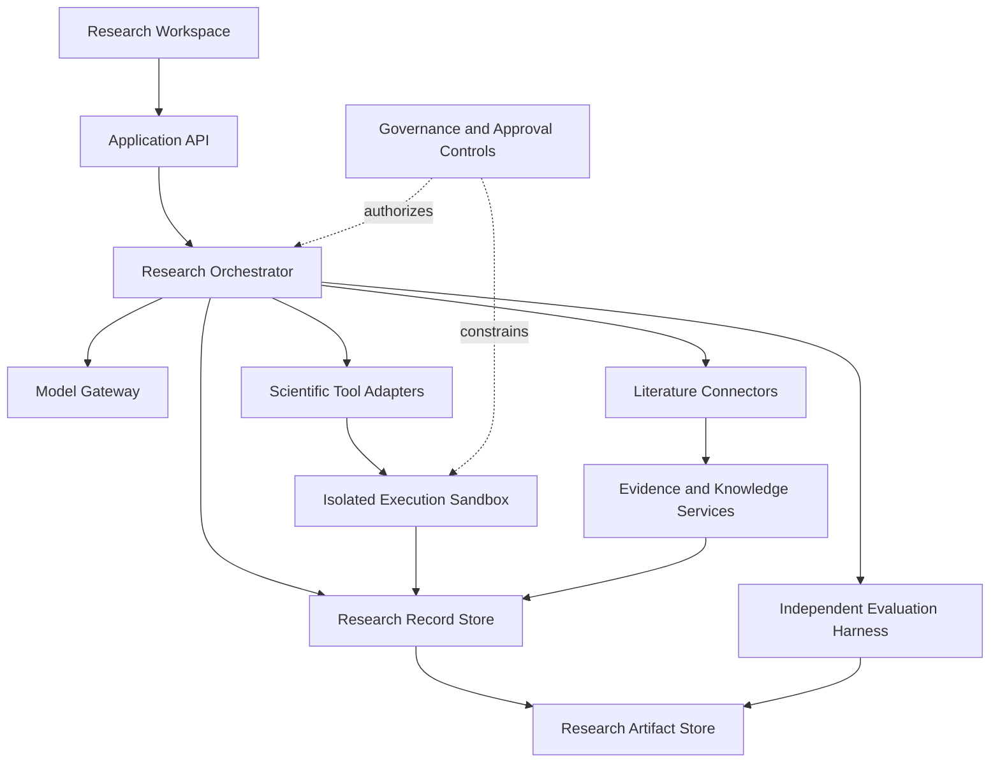

# Proposed System Architecture

**Status:** Partially implemented; this document is the target logical architecture, and the implementation boundary is recorded below  
**Principle:** Separate the research interface, coordination logic, scientific execution, evidence, persistence, and evaluation.

## 1. Logical components

1. **Research workspace UI** — submits research tasks and displays evidence, experiments, logs, reports, and approvals.
2. **Application API** — FastAPI routes validate structured requests; production OIDC bearer validation, tenant membership and action authorization are implemented at the records/lab service boundary. A live provider is not yet configured.
3. **Research orchestrator** — executes explicit, stateful workflows; maintains task state; delegates bounded tasks; and handles pause, resume, failure, and approval points.
4. **Model gateway** — target provider-neutral interface for local or remote language models and embeddings. No production inference provider or real model invocation is currently configured.
5. **Literature connectors** — search permitted academic indexes and repositories, normalize metadata, and preserve source identifiers.
6. **Evidence and knowledge services** — store documents, claims, citations, terminology, relationships, and uncertainty labels.
7. **Scientific tool adapters** — expose symbolic math, numerical calculations, data analysis, plotting, and approved simulation tools.
8. **Execution sandbox** — runs approved computational tasks with resource limits and restricted filesystem/network access.
9. **Research record store** — stores hypotheses, experiment definitions, runs, reviews, task state, and provenance.
10. **Artifact store** — stores reports, tables, plots, source files, environment manifests, and checksums.
11. **Evaluation harness** — tests scientific correctness, citation fidelity, reproducibility, safety, and regressions.
12. **Governance controls** — enforce action permissions, approval requirements, audit events, stop mechanisms, and rollback.

## 2. High-level data flow

The diagram represents the target logical architecture. It is not a claim that every connector, worker, model gateway or deployment topology exists.

## 3. Research task lifecycle

Represent each research task with an explicit state and immutable event history where practical:

- `created`
- `scoping`
- `literature_review`
- `hypothesis_draft`
- `experiment_planned`
- `awaiting_approval` when required
- `running`
- `verification`
- `review`
- `completed`, `failed`, `cancelled`, or `blocked`

Every transition should be validated. Failed or interrupted work must remain inspectable and must not be silently marked successful.

## 4. Core records

Design the persistent model around, at minimum:

- ResearchTask
- ResearchQuestion
- SourceRecord
- ClaimRecord
- Hypothesis
- ExperimentPlan
- ExperimentRun
- DatasetReference
- Artifact
- VerificationCheck
- ReviewFinding
- Approval
- AuditEvent
- ModelInvocation
- EvaluationRun

Record stable IDs, timestamps, versions, relationships, provenance, status, and relevant hashes. Avoid storing secrets or unnecessary personal data in research records.

## 5. Evidence model

Claims should be classified explicitly, for example:

- source-reported;
- independently retrieved and corroborated;
- computed;
- experimentally observed;
- inferred;
- proposed hypothesis;
- disputed or contradicted; or
- unverified.

A reference's existence does not prove that it supports a claim. Store the exact source location or supporting passage when legally and technically appropriate. Retain source URL, title, creator metadata, publication/version date, retrieval time, identifiers, and any correction/retraction status found.

## 6. Tool and model interfaces

Keep model providers and tool implementations behind typed interfaces. Research workflows should depend on capabilities (such as `search_literature`, `run_symbolic_calculation`, or `execute_approved_experiment`) rather than provider-specific behavior.

Use structured inputs and outputs. Validate outputs before use, apply timeouts and resource limits, record model/tool versions, and handle unavailable dependencies explicitly.

## 7. Security boundaries

- Treat retrieved documents, web pages, source code, datasets, and model outputs as untrusted data.
- Do not allow retrieved instructions to override policy or grant access.
- Keep credentials outside source control and logs.
- Do not run generated code with unrestricted access to the host operating system.
- Begin with no autonomous external publishing, purchases, hardware control, or hazardous physical experimentation.
- Require explicit authorization for external side effects and consequential research.
- Add audit logging, permission checks, and an emergency stop before increasing autonomy.

A Python subprocess alone is not a sufficient security sandbox. Evaluate a properly isolated execution boundary before permitting general agent-generated code.

## 8. Reliability and observability

Log task events, model/tool calls, failures, execution duration, relevant resource usage, decisions, approvals, and artifact checksums. Redact credentials and sensitive data. Provide tracebacks and actionable failure states without treating a successful API response as proof of scientific validity.

## 9. Deployment evolution

Start with a local process and a small dependency footprint. Keep interfaces modular so storage, model runtime, execution isolation, or compute can later be replaced. Do not introduce distributed services or orchestration infrastructure until measured scale or reliability needs justify them.

## 10. Architecture implementation status

The repository contains substantial implementation, but the logical architecture above is not fully operational end to end.

| Component | Current implementation | Remaining acceptance boundary |
|---|---|---|
| Research workspace UI | React application has initial screens for all 12 planned workspaces, typed API client, navigation and automated accessibility coverage | Role-specific browser acceptance with live OIDC, live API and persistent data is not complete |
| Application API | FastAPI routes for records, literature metadata, knowledge, math, lab, autonomy, memory, manuscripts, OIDC session discovery and readiness | Live provider configuration, production backend hosting, external TLS and operational acceptance are open |
| Research orchestrator | Tenant-scoped finite-state workflow engine, checkpoints, approval token and recovery primitives | No durable distributed job queue or end-to-end orchestration of the complete multi-service research cycle |
| Model gateway | No configured production gateway or inference provider | Provider selection, data governance, cost approval, credentials and model evaluation are required |
| Literature connectors | OpenAlex and Crossref metadata adapters | No full-text processing, claim extraction or source-to-claim verification |
| Evidence and knowledge services | Tenant-scoped records, concept vocabulary, relationships, graph neighbourhoods, memory versions and manuscript citation records | Source record integrity/identifier checks do not establish that a source supports a claim; human expert assessment remains necessary |
| Scientific tool adapters | Bounded SymPy/SciPy/NumPy/Pint operations, statistics, plots and deterministic hypothesis templates | Domain breadth and scientific correctness require versioned independent benchmark and domain-expert validation |
| Execution sandbox | Fixed allowlisted worker image, Docker adapter code and fail-closed production adapter selection; CI builds and smoke-tests the image | No reviewed production host/service deployment or independent adversarial OS-isolation acceptance |
| Research record store | Immutable checksum-verified SQLite records with tenant scopes | SQLite is single-node storage; PostgreSQL migration and high-availability operation are not implemented |
| Artifact store | SQLite-linked JSON and binary lab artifacts with checksums, quotas and export | Durable object storage, independent backup lifecycle and restore in the target environment remain open |
| Evaluation harness | Deterministic numerical smoke benchmark and regression tests | Independent benchmark replication, domain expert review and broader scientific validity evaluation remain open |
| Governance controls | Role/action matrix, authorization audit, memory contradiction/rollback, manuscript draft controls and read-only review/approval evidence viewer | Named reviewer identity, separation of duties, authenticated approval decisions and independent sign-off are not complete |

### Authentication and tenant trust

The browser is a public OIDC Authorization Code + PKCE client. Access tokens are held in memory and attached to API requests; the browser's tenant selection is not trusted as authorization. The API validates the signed token against operator-configured issuer, audience and JWKS settings, resolves the principal and checks active server-side membership and action permission. Operator tooling provisions tenant membership separately; login does not grant administrator privileges.

The source code and automated protocol tests do not prove that a real identity provider, redirect registration, token audience, CORS policy, JWKS rotation or live user memberships have been configured and accepted.

### Deployment topology

The repository now includes a non-root FastAPI container and a single-node Compose template with a durable named SQLite volume, read-only container root and resource limits. It does not create DNS, TLS termination, a public backend host, managed database, backup service or monitoring pipeline. The API binds to loopback and is intended to sit behind a separately managed TLS reverse proxy.

The API does not mount the Docker socket. A production lab execution service must be a separately reviewed workload boundary and must not inherit API credentials or host filesystem access.

No component should be considered production-operational until its target environment is deployed, its required tests pass on the exact candidate, and external evidence is recorded. Architectural changes must be captured in a decision record.
