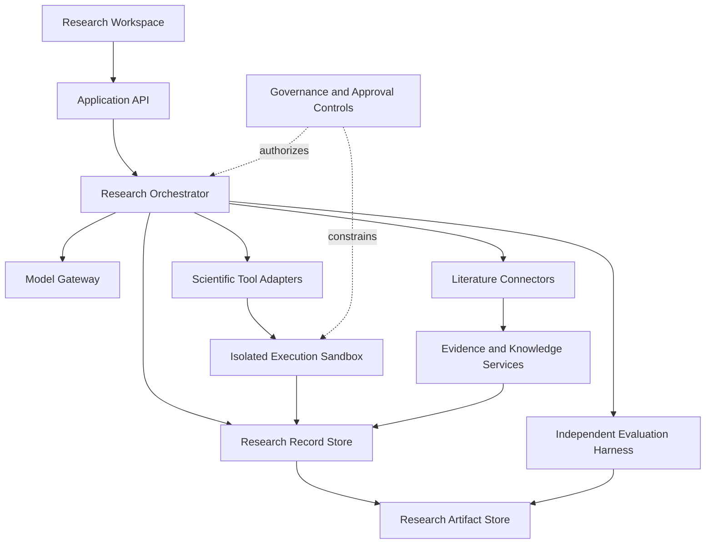

# Proposed System Architecture

**Status:** Initial design; not yet implemented  
**Principle:** Separate the research interface, coordination logic, scientific execution, evidence, persistence, and evaluation.

## 1. Logical components

1. **Research workspace UI** — submits research tasks and displays evidence, experiments, logs, reports, and approvals.
2. **Application API** — validates requests, applies authentication/authorization when introduced, manages task lifecycle, and exposes versioned endpoints.
3. **Research orchestrator** — executes explicit, stateful workflows; maintains task state; delegates bounded tasks; and handles pause, resume, failure, and approval points.
4. **Model gateway** — provides provider-neutral interfaces to local or remote language models, embeddings, and other compatible services.
5. **Literature connectors** — search permitted academic indexes and repositories, normalize metadata, and preserve source identifiers.
6. **Evidence and knowledge services** — store documents, claims, citations, terminology, relationships, and uncertainty labels.
7. **Scientific tool adapters** — expose symbolic math, numerical calculations, data analysis, plotting, and approved simulation tools.
8. **Execution sandbox** — runs approved computational tasks with resource limits and restricted filesystem/network access.
9. **Research record store** — stores hypotheses, experiment definitions, runs, reviews, task state, and provenance.
10. **Artifact store** — stores reports, tables, plots, source files, environment manifests, and checksums.
11. **Evaluation harness** — tests scientific correctness, citation fidelity, reproducibility, safety, and regressions.
12. **Governance controls** — enforce action permissions, approval requirements, audit events, stop mechanisms, and rollback.

## 2. High-level data flow

The diagram is a proposed logical design, not a representation of existing code.

## 3. Research task lifecycle

Represent each research task with an explicit state and immutable event history where practical:

- `created`
- `scoping`
- `literature_review`
- `hypothesis_draft`
- `experiment_planned`
- `awaiting_approval` when required
- `running`
- `verification`
- `review`
- `completed`, `failed`, `cancelled`, or `blocked`

Every transition should be validated. Failed or interrupted work must remain inspectable and must not be silently marked successful.

## 4. Core records

Design the persistent model around, at minimum:

- ResearchTask
- ResearchQuestion
- SourceRecord
- ClaimRecord
- Hypothesis
- ExperimentPlan
- ExperimentRun
- DatasetReference
- Artifact
- VerificationCheck
- ReviewFinding
- Approval
- AuditEvent
- ModelInvocation
- EvaluationRun

Record stable IDs, timestamps, versions, relationships, provenance, status, and relevant hashes. Avoid storing secrets or unnecessary personal data in research records.

## 5. Evidence model

Claims should be classified explicitly, for example:

- source-reported;
- independently retrieved and corroborated;
- computed;
- experimentally observed;
- inferred;
- proposed hypothesis;
- disputed or contradicted; or
- unverified.

A reference's existence does not prove that it supports a claim. Store the exact source location or supporting passage when legally and technically appropriate. Retain source URL, title, creator metadata, publication/version date, retrieval time, identifiers, and any correction/retraction status found.

## 6. Tool and model interfaces

Keep model providers and tool implementations behind typed interfaces. Research workflows should depend on capabilities (such as `search_literature`, `run_symbolic_calculation`, or `execute_approved_experiment`) rather than provider-specific behavior.

Use structured inputs and outputs. Validate outputs before use, apply timeouts and resource limits, record model/tool versions, and handle unavailable dependencies explicitly.

## 7. Security boundaries

- Treat retrieved documents, web pages, source code, datasets, and model outputs as untrusted data.
- Do not allow retrieved instructions to override policy or grant access.
- Keep credentials outside source control and logs.
- Do not run generated code with unrestricted access to the host operating system.
- Begin with no autonomous external publishing, purchases, hardware control, or hazardous physical experimentation.
- Require explicit authorization for external side effects and consequential research.
- Add audit logging, permission checks, and an emergency stop before increasing autonomy.

A Python subprocess alone is not a sufficient security sandbox. Evaluate a properly isolated execution boundary before permitting general agent-generated code.

## 8. Reliability and observability

Log task events, model/tool calls, failures, execution duration, relevant resource usage, decisions, approvals, and artifact checksums. Redact credentials and sensitive data. Provide tracebacks and actionable failure states without treating a successful API response as proof of scientific validity.

## 9. Deployment evolution

Start with a local process and a small dependency footprint. Keep interfaces modular so storage, model runtime, execution isolation, or compute can later be replaced. Do not introduce distributed services or orchestration infrastructure until measured scale or reliability needs justify them.

## 10. Architecture status

No component in this document should be considered implemented until code exists, required tests pass, and the results are recorded. Architectural changes must be captured in a decision record.
